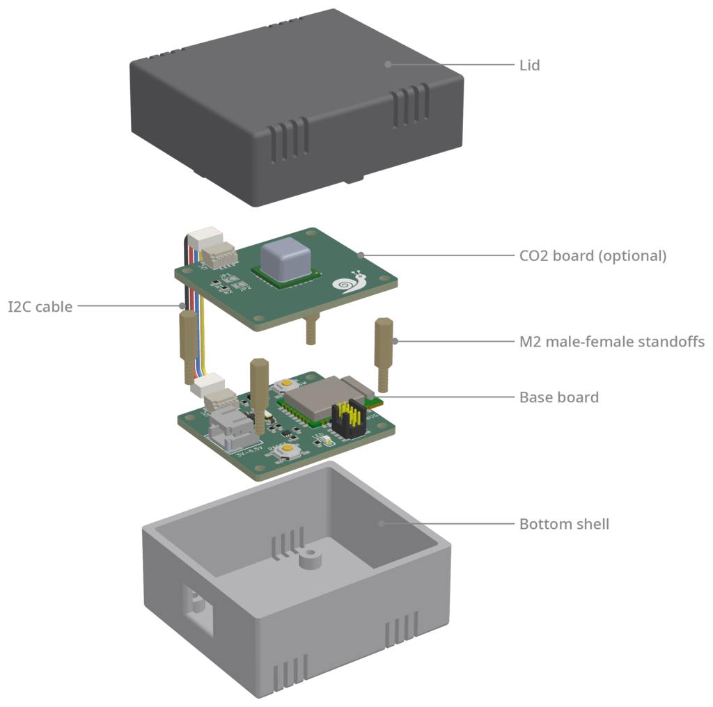
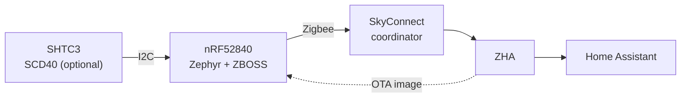
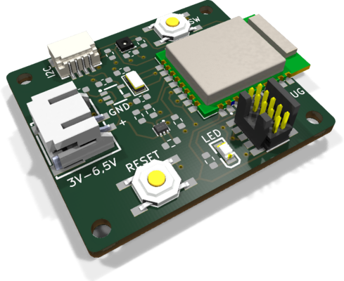
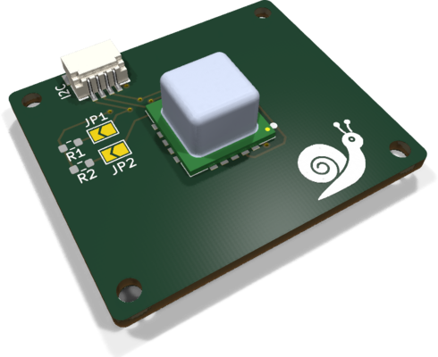

# Schneggi sensor 🐌

[](https://github.com/Rogger/schneggi-sensor/actions/workflows/main.yml)
[](LICENSE.md)

A tiny Zigbee sensor for [Home Assistant](https://www.home-assistant.io/) that measures temperature, humidity and, optionally, CO2.
It runs on an nRF52840, updates over the air through ZHA, and lasts a long time on a small battery.

<p align="center"></p>

## At a glance

|  | 🔋 Base | 🌬️ CO2 |
| --- | --- | --- |
| **Sensors** | [SHTC3](https://www.sensirion.com/products/catalog/SHTC3/) temperature + humidity | + [SCD40](https://sensirion.com/products/catalog/SCD40) CO2 and a second temperature |
| **Power** | 3–6 V via JST (e.g. 350 mAh Li-Po), ~3 µA average (measured before OTA support) | USB-C, no battery reported |
| **Zigbee role** | Sleepy end device | End device, receiver always on |
| **Sampling** | 1 min (debug) / 10 min (production) | 1 min (debug) / 10 min (production) |
| **OTA via ZHA** | ✅ | ✅ |
| **PCB** | 35 × 30 mm | 35 × 30 mm base + add-on board |
| **Case** | ≈ 50 × 44 × 35 mm, 3D printed | same case |

Tested with Home Assistant ZHA and [SkyConnect](https://www.home-assistant.io/skyconnect/).

## How it fits together



## Home Assistant


- Pair it like any Zigbee device in ZHA. No custom quirk is required.
- On the CO2 variant, endpoint 1 is the SHTC3 temperature and endpoint 2 is the SCD40 temperature. Rename them to tell them apart ([details](docs/zigbee-reporting.md)).
- Firmware updates appear as a normal update entity once [OTA is configured](docs/ota.md).

## Quick start

Requires Nordic's `nrfutil` and a SEGGER J-Link on the board's 10-pin debug header (see the [flash adapter](hardware/flash_adapter) PCB). The firmware uses nRF Connect SDK 3.4.1 and Zigbee add-on 1.4.0.

```bash
nrfutil install toolchain-manager device
nrfutil toolchain-manager install --ncs-version v3.4.1 --install-dir "$HOME/ncs"
nrfutil toolchain-manager launch --ncs-version v3.4.1 --install-dir "$HOME/ncs" -- west init -l .
make west-update
make build-debug OTA_ALLOW_TEST_KEY=ON && make flash-debug SNR=<your_jlink_serial>
make test
```

|  | Base | CO2 |
| --- | --- | --- |
| **Debug** | `make build-debug` | `make build-debug-co2` |
| **Production** | `make build-production` | `make build-production-co2` |

Each `build-*` target has a matching `flash-*` target. Every build needs `OTA_SIGNING_KEY=/absolute/path/key.pem`, or `OTA_ALLOW_TEST_KEY=ON` for development only. Pass `SNR=` with your J-Link serial number when flashing.
See [build.md](docs/build.md) for workspace options, overrides and test coverage.

## Docs

| | Topic | |
| --- | --- | --- |
| 🔧 | [Build, test and flash](docs/build.md) | Workspace setup, profiles, overrides |
| ⬆️ | [OTA updates](docs/ota.md) | Signing, ZHA configuration, recovery |
| 🚀 | [Releases](docs/releases.md) | GitHub release workflow |
| 📡 | [Zigbee endpoints and reporting](docs/zigbee-reporting.md) | Endpoints, reporting configuration |
| 🔋 | [Battery power management](docs/power.md) | I2C power management, rejoin backoff, battery sampling |
| 🩺 | [Reset diagnostics](docs/diagnostics.md) | Reading the reset cause from Home Assistant |
| 🧱 | [SDK 3.4.1 migration](docs/sdk-upgrade.md) | Upgrade notes |

## Hardware

The sensor PCBs were designed in KiCad 7 (the flash adapter in KiCad 9) and manufactured and assembled by JLCPCB. Schematics, layouts, JLCPCB production files and case STLs are in [`hardware/`](hardware); the [flash adapter](hardware/flash_adapter) has its own notes.

|  |  |
| :---: | :---: |
| Base board | CO2 add-on board |

The renders are generated from the KiCad boards and case STLs with `uv run scripts/render_images.py`.

## Resources

- PCB design inspired by [Getting Started With nRF52 MCU in a PCB](https://resources.altium.com/p/getting-started-nrf52-mcu-pcb#getting-started-schematics)
- [zigbee-plant-sensor](https://github.com/stanvn/zigbee-plant-sensor) and [b-parasite](https://github.com/rbaron/b-parasite) are great starting points
- [Zephyr SCD4X driver](https://github.com/nrfconnect/sdk-zephyr/tree/ncs-v3.4.1/drivers/sensor/sensirion/scd4x)
- [nRF Sniffer](https://developer.nordicsemi.com/nRF_Connect_SDK/doc/latest/nrf/protocols/zigbee/tools.html) with [Wireshark](https://www.wireshark.org) for debugging Zigbee traffic
- [Zigbee specification R22](https://csa-iot.org/wp-content/uploads/2022/01/docs-05-3474-22-0csg-zigbee-specification-1.pdf) and [Zigbee Cluster Library R8](https://zigbeealliance.org/wp-content/uploads/2021/10/07-5123-08-Zigbee-Cluster-Library.pdf)

## License

[GPL-3.0](LICENSE.md)
